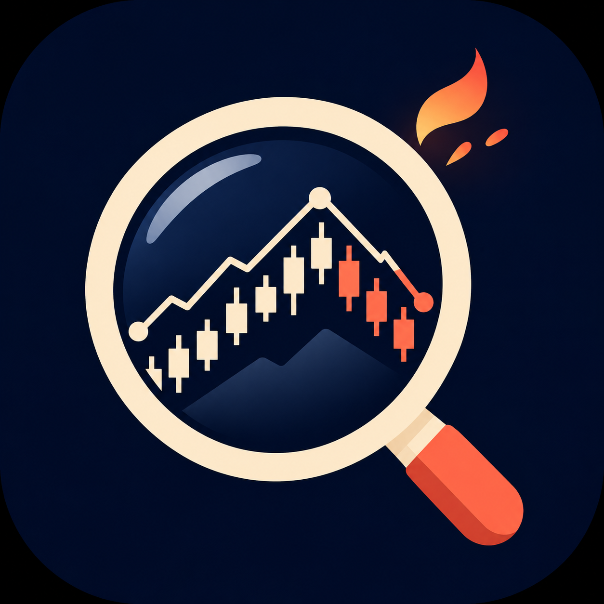

<p align="center">
  
</p>

<h1 align="center">Portfolio Roaster</h1>

<p align="center"><strong>Your portfolio, researched. Your blind spots, roasted.</strong></p>

Portfolio Roaster is a project-scoped Codex skill that turns a screenshot or list of holdings into a concise, evidence-backed portfolio briefing. It researches what has happened, what is coming, and what those developments might mean for your holdings—then gives you a clear point of view.

## What you get

- **A clear verdict:** an overall assessment and the highest-priority action to consider.
- **Events that matter:** recent developments and upcoming catalysts, with dates and context.
- **Holding-by-holding opinions:** buy, hold, reduce, sell, or insufficient evidence, with the reasoning behind each view.
- **Portfolio perspective:** concentration, overlapping exposures, geographic and sector risks, when the available data supports them.
- **A deeper dive:** company fundamentals, valuation and technical context, analyst expectations, and competing scenarios where useful.

The tone can be playful. The research takes priority.

## Use it in Codex

Open this repository as your Codex project, start a chat, and attach a screenshot of your holdings or provide a list of names and tickers. Then ask:

> Use $portfolio-roaster to research and roast my portfolio.

Codex discovers the skill from `.agents/skills/portfolio-roaster/` when working in this repository; it does not need to be installed globally. For a more useful portfolio-level assessment, include position values or percentages and say whether the holdings represent the whole portfolio. You can obscure account numbers and other identifying information.

## How the research works

The skill searches for current evidence on each run, prioritizing company disclosures, regulatory filings, issuer fund documents, exchange notices, reputable market data and independent reporting. It attempts to cover stocks and ETFs globally, while making gaps, ambiguous listings, delayed prices and uncertain event dates explicit.

It distinguishes company results, management guidance, analyst estimates and its own interpretation. Material claims should link to their sources; a concise briefing comes first, with supporting research below it. Access, market coverage and data quality vary, so a verdict may be withheld when the evidence is insufficient.

## Scope

Portfolio Roaster is an on-demand AI research skill, not a brokerage, real-time market feed or continuous monitoring service. It does not have access to your full financial circumstances unless you provide them. Outputs are general information, **not personalized investment advice**; market data, AI-generated analysis and opinions can be incomplete or wrong.

## Project structure

```text
.agents/skills/portfolio-roaster/
├── SKILL.md             # Research workflow and response instructions
├── agents/openai.yaml   # Codex display metadata
└── assets/              # Project icon
```
